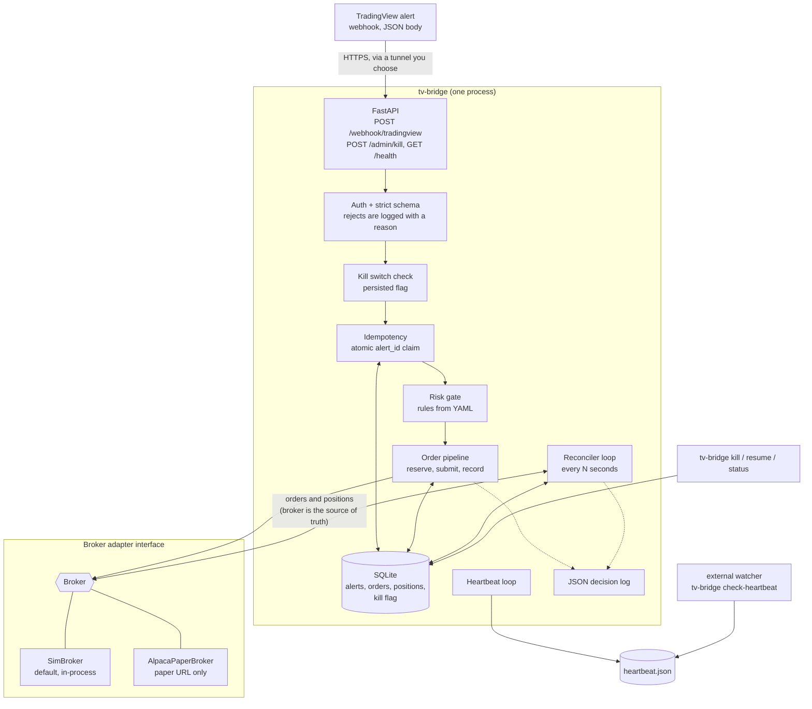

# tv-broker-bridge

> **Engineering demonstration only. Not investment advice. No strategy is included. Use paper trading. You are responsible for any use with a live account.**

A small, carefully tested service that receives **TradingView alert webhooks** and turns them into **broker orders** without double-sending, without skipping risk checks, and without silently drifting out of sync with the broker.

It is a portfolio piece about *reliable order handling*. It contains **no trading strategy, no signals, and no performance claims**: what to trade, and when, is entirely up to whoever writes the alerts. It ships with an in-process paper broker (`SimBroker`) and an optional [Alpaca](https://alpaca.markets) **paper-trading** adapter that refuses to run against a live endpoint.

## What it does

| # | Capability | Where |
|---|------------|-------|
| 1 | FastAPI webhook receiver: shared-secret check, strict schema validation, malformed input rejected **with a logged reason** | `app.py`, `schemas.py` |
| 2 | **Idempotency**: a repeated `alert_id` never places a second order (SQLite, atomic claim) | `processor.py`, `db.py` |
| 3 | **Risk gate** before any order, from YAML: max qty/order, max position/symbol, max orders/day, allowed symbols, trading-hours window. Rejections are logged, never silent | `risk.py` |
| 4 | **Broker adapter interface** with `SimBroker` (fills, partial fills, rejects, latency, injected failures) and `AlpacaPaperBroker` (paper URL only, keys from env only, tests use mocked HTTP) | `broker/` |
| 5 | **Reconciliation loop**: every *N* seconds compare local orders/positions with the broker's; log + alert on any mismatch; **the broker is the source of truth** | `reconcile.py` |
| 6 | **Kill switch**: CLI command *and* secret-protected HTTP endpoint; stops accepting alerts and cancels all working orders | `kill_switch.py` |
| 7 | **Structured JSON logs** of every decision: `received`, `deduped`, `rejected_by_risk`, `sent`, `filled`, `reconciled`, … | `logging_utils.py` |
| 8 | **`/health`** endpoint and a **heartbeat file** another process can watch (`tv-bridge check-heartbeat`) | `runtime.py`, `heartbeat.py` |

## Architecture



**Life of one alert**

1. **Authenticate** (`X-Webhook-Secret` header, or the `secret` field TradingView puts in the body; constant-time compare) and **validate strictly**: no coercion, no unknown fields, no duplicate keys, no `NaN`. Failures are logged with the reason and never reach the broker.
2. **Kill switch** engaged? Refuse with `503 halted`.
3. In **one `BEGIN IMMEDIATE` transaction**: look up the `alert_id` (duplicate → stop), evaluate the risk rules against current exposure, then record the alert and a `PENDING_SUBMIT` order. The reservation counts toward limits while the order is in flight.
4. **Submit** to the broker with a `client_order_id` derived from the `alert_id` (so re-sending is idempotent *at the broker too*), retrying briefly on connection errors.
5. **Record** the broker's answer; book fills into the local position.
6. Later, the **reconciler** compares everything with the broker and corrects the local side.

If step 4 cannot get an answer, the order is parked as `SUBMIT_UNKNOWN`: it still counts as exposure, the same `alert_id` may retry delivery, and the reconciler resolves it. Details and the full failure table are in [`docs/DESIGN.md`](docs/DESIGN.md).

## Quick start (SimBroker, about 5 minutes)

Requires Python 3.11+ and `make`. No account, API key or network access to a broker is needed.

```bash
git clone https://github.com/AZG-Engineering/tv-broker-bridge-demo.git
cd tv-broker-bridge-demo

make install    # creates .venv and installs the package + dev tools
make init       # writes .env with fresh random secrets, and config/risk.yaml
make run        # serves on http://127.0.0.1:8000 with SimBroker
```

In a second terminal:

```bash
make demo       # sends a valid order, a duplicate, a risk reject, a malformed alert, a bad secret
tv-bridge status          # (after `source .venv/bin/activate`) positions, working orders, heartbeat
tv-bridge check-heartbeat # exit 0 if the heartbeat file is fresh
```

Prefer to see the raw request? With the secrets from `.env`:

```bash
curl -s http://127.0.0.1:8000/webhook/tradingview \
  -H 'Content-Type: application/json' \
  -d '{"secret":"<WEBHOOK_SECRET from .env>","alert_id":"hello-1","symbol":"AAPL","side":"buy","qty":10,"order_type":"market"}'
```

Sample responses from a real run (`make demo`):

```text
1. A valid market order
  -> HTTP 200 {"status": "accepted", "alert_id": "demo-…", "order": {"status": "filled", "qty": "10", "filled_qty": "10", …}}
2. The same alert_id again (TradingView retry / double click)
  -> HTTP 200 {"status": "duplicate", "alert_id": "demo-…", "original_state": "accepted"}
3. Quantity above max_qty_per_order
  -> HTTP 200 {"status": "rejected_by_risk", "violations": [{"code": "qty_exceeds_max_per_order", …}, …]}
4. Malformed: qty sent as a string
  -> HTTP 400 {"status": "rejected", "error": "schema_validation_failed", "details": [{"field": "qty", …}]}
5. Wrong secret
  -> HTTP 401 {"status": "unauthorized"}
```

## Alert format

```json
{
  "secret": "<WEBHOOK_SECRET>",
  "alert_id": "unique-per-intended-order",
  "symbol": "AAPL",
  "side": "buy",
  "qty": 10,
  "order_type": "market"
}
```

| Field | Rules |
|-------|-------|
| `alert_id` | string, 1-64 chars, `[A-Za-z0-9][A-Za-z0-9_.:-]*`. **The idempotency key.** |
| `symbol` | upper-case ticker, `[A-Z][A-Z0-9.-]{0,9}`; no silent upper-casing |
| `side` | `"buy"` or `"sell"` |
| `qty` | JSON **integer** 1 to 1,000,000 (whole shares; `"10"` and `10.0` are rejected) |
| `order_type` | `"market"` or `"limit"` |
| `limit_price` | JSON number > 0; **required** for `limit`, must be absent or `null` for `market` |
| `secret` | the shared secret (or send it in the `X-Webhook-Secret` header instead) |

Anything else (extra fields, wrong types, duplicate keys, `NaN`, bodies over 16 KiB) is rejected with a `400`/`413` and a `rejected_malformed` log line naming the field and error type, never echoing the offending value.

## Pointing TradingView at it

The bridge listens on `127.0.0.1` by default. TradingView must reach it over the public internet, so you need *something* in front of it, and that choice is yours. A tunnel such as [ngrok](https://ngrok.com) is one common option for experimenting (`ngrok http 8000`); a reverse proxy on a host you control is another. This project is not affiliated with or endorsed by any tunnel provider.

1. Start the bridge and your tunnel/proxy of choice, then copy the public **HTTPS** URL.
2. In TradingView, create an alert → **Notifications → Webhook URL** → `https://<your-public-host>/webhook/tradingview`.
3. Put the JSON from [Alert format](#alert-format) in the alert **message**, with your `WEBHOOK_SECRET`. A typical dynamic version uses TradingView placeholders:
   ```json
   {"secret": "<WEBHOOK_SECRET>", "alert_id": "{{ticker}}-{{timenow}}", "symbol": "{{ticker}}",
    "side": "buy", "qty": 1, "order_type": "market"}
   ```
   (Check TradingView's current docs for what each placeholder renders; the bridge is strict about the result.)

Things to know (per TradingView's webhook documentation at the time of writing; please re-check it):

- TradingView **cannot set custom headers**, which is why the secret travels in the JSON body. The secret is stripped before validation and never logged.
- TradingView gives up on a webhook after **about 3 seconds** and only calls ports 80/443. With defaults, a request can take longer than that only when the broker is failing (worst case ≈ `SUBMIT_ATTEMPTS × BROKER_TIMEOUT_S` + backoff ≈ 6.6 s). The bridge **finishes processing regardless**, and the pipeline is idempotent, so a timeout on TradingView's side is safe.
- A public URL is a public attack surface. Use a long random secret, keep `/admin/kill` on a separate secret, and if your proxy supports it, allow-list TradingView's published source IPs.
- The built-in docs/OpenAPI pages are disabled, and `/health` reveals no secrets.

## Configuration

Environment variables (`.env` is read by the CLI; see [`.env.example`](.env.example)). The process **refuses to start** on a missing, short, placeholder or duplicated secret, an unknown broker name, a non-paper Alpaca URL, or an invalid risk file.

| Variable | Default | Meaning |
|----------|---------|---------|
| `WEBHOOK_SECRET` | *required* | shared secret for `/webhook/tradingview` (16+ chars) |
| `ADMIN_SECRET` | *required* | separate secret for `/admin/kill`; must differ |
| `BROKER` | `sim` | `sim` or `alpaca_paper` |
| `ALPACA_API_KEY_ID`, `ALPACA_API_SECRET_KEY` | none | paper keys, read **only** from the environment |
| `ALPACA_BASE_URL` | `https://paper-api.alpaca.markets` | anything else aborts startup |
| `RISK_CONFIG_PATH` | `config/risk.yaml` | risk rules (below) |
| `DB_PATH` | `data/bridge.db` | SQLite file (alerts, orders, positions, kill flag) |
| `HEARTBEAT_PATH` | `data/heartbeat.json` | heartbeat file |
| `RECONCILE_INTERVAL_S` | `30` | seconds between reconciliation passes |
| `HEARTBEAT_INTERVAL_S` | `5` | seconds between heartbeats (also retries a pending kill-cancel) |
| `SUBMIT_ATTEMPTS` / `SUBMIT_BACKOFF_S` / `BROKER_TIMEOUT_S` | `3` / `0.2` / `2` | per-alert delivery retries |
| `UNKNOWN_GRACE_S` | `120` | how long an unconfirmed order may be retried before it is failed |
| `LOG_LEVEL`, `LOG_FILE` | `INFO`, none | JSON logs go to stdout, and optionally a rotating file |
| `SIM_LATENCY_MS`, `SIM_PARTIAL_FILL_PROB`, `SIM_REJECT_PROB`, `SIM_SEED`, `SIM_DEFAULT_PRICE` | off | make SimBroker misbehave (reproducibly with a seed) |

### Risk rules (`config/risk.yaml`)

Every key is mandatory and unknown keys are an error, so a typo cannot silently disable a limit. All violated rules are reported together.

```yaml
max_qty_per_order: 100        # qty_exceeds_max_per_order
max_position_per_symbol: 250  # position_limit_exceeded: |net position + working orders + this order|
max_orders_per_day: 50        # daily_order_limit_exceeded: orders attempted today (broker-rejected ones count)
allowed_symbols: [AAPL, MSFT, SPY]   # symbol_not_allowed
trading_hours:                # outside_trading_hours
  enabled: true
  timezone: UTC               # any IANA zone, e.g. America/New_York (DST-aware)
  start: "00:00"              # inclusive
  end: "24:00"                # exclusive
  days: [mon, tue, wed, thu, fri, sat, sun]
```

The numbers in the example file are arbitrary demo values, not recommendations. Orders that **reduce** exposure are always allowed by the position rule, so a position that drifted over the limit can still be worked down.

## HTTP API

| Endpoint | Auth | Responses |
|----------|------|-----------|
| `POST /webhook/tradingview` | `secret` in body or `X-Webhook-Secret` | `200` with `status` = `accepted` · `duplicate` · `rejected_by_risk` · `rejected_by_broker`; `400` malformed; `401` bad/missing secret; `413` too large; `503` `halted` or `broker_unavailable` (`retryable: true`); `502` broker auth error |
| `POST /admin/kill` | `X-Admin-Secret` | `200` halted and all working orders canceled; `202` halted but the cancel is pending (broker unreachable; retried automatically); `401` |
| `GET /health` | none | `200` `ok`/`halted`; `503` `degraded` (reconcile failing/stale, or a mismatch on the last pass) |

HTTP status describes the *request*; the decision is in the body. A risk reject is a `200` because the alert was understood and handled.

## CLI

```text
tv-bridge serve [--host 127.0.0.1] [--port 8000]   run the server (refuses to start on bad config)
tv-bridge kill [--reason TEXT]                      halt + cancel working orders (works with the server down for Alpaca)
tv-bridge resume                                    release the kill switch (deliberately CLI-only)
tv-bridge status                                    kill switch, positions, working orders, last heartbeat
tv-bridge check-heartbeat [--max-age 30]            exit 0 if fresh, 1 if stale/missing (for cron / probes)
```

The kill flag lives in SQLite, so the CLI and the server (separate processes) share it, and it **survives restarts**. SimBroker is in-process, so `tv-bridge kill` can only set the flag; the running server then cancels its own orders within one heartbeat tick. With Alpaca the CLI cancels directly.

## Logs

One JSON object per line; secrets are redacted by key name as a second line of defence.

```json
{"ts":"2026-10-09T20:43:01.602+00:00","level":"INFO","event":"received","alert_id":"demo-1","symbol":"AAPL","side":"buy","qty":10,"order_type":"market","limit_price":null}
{"ts":"2026-10-09T20:43:01.604+00:00","level":"INFO","event":"sent","alert_id":"demo-1","client_order_id":"tvb-19d5…","broker_order_id":"sim-000001","broker_status":"filled"}
{"ts":"2026-10-09T20:43:01.605+00:00","level":"INFO","event":"filled","alert_id":"demo-1","fill_qty":"10","filled_qty":"10","remaining_qty":"0","avg_fill_price":"100.00","partial":false}
{"ts":"2026-10-09T20:43:01.608+00:00","level":"INFO","event":"deduped","alert_id":"demo-1","original_state":"accepted","payload_matches":true}
{"ts":"2026-10-09T20:43:01.610+00:00","level":"WARNING","event":"rejected_by_risk","alert_id":"demo-1-big","codes":["qty_exceeds_max_per_order","position_limit_exceeded"]}
```

| Event | Meaning |
|-------|---------|
| `received` · `deduped` · `rejected_by_risk` · `sent` · `filled` · `reconciled` | the core decision trail |
| `rejected_malformed` · `auth_failed` · `rejected_halted` | refused before reaching the pipeline |
| `broker_rejected` · `submit_retry` · `submit_gave_up` · `submit_unknown` · `broker_auth_error` | delivery problems |
| `reconcile_mismatch` · `alert` · `reconcile_failed` · `reconcile_skipped` · `broker_reconnected` | reconciliation |
| `kill_switch_engaged` · `kill_switch_orders_canceled` · `kill_switch_cancel_failed` · `kill_switch_released` | kill switch |

Every mismatch the reconciler finds is logged as `reconcile_mismatch` (ERROR) *and* sent to an `AlertSink`. The default sink emits an ERROR `alert` event; implement the one-method protocol in `alerting.py` to page someone instead.

## Using the Alpaca paper adapter (optional)

```bash
# in .env
BROKER=alpaca_paper
ALPACA_API_KEY_ID=<your PAPER key id>
ALPACA_API_SECRET_KEY=<your PAPER secret>
ALPACA_BASE_URL=https://paper-api.alpaca.markets
```

Safeguards, each with tests:

- The URL must be **exactly** `https://paper-api.alpaca.markets`. The live host, look-alike domains, `http`, embedded credentials, odd ports/paths/queries, trailing dots and Unicode homoglyphs are all refused **at startup**.
- The same check runs again on **every request**, and **redirects are never followed**.
- Keys come from environment variables only, travel only in request headers, and never appear in `repr`, errors or logs.
- The test suite never contacts Alpaca; HTTP is mocked with `httpx.MockTransport`.

## Development

```bash
make check      # ruff lint + format check, mypy --strict, pytest (what CI runs)
make test       # just pytest
make format     # auto-fix
```

The suite runs entirely on `SimBroker` and mocked HTTP: no network, no real clock (time is injected), no sleeps. It covers duplicate alerts (including concurrent ones and restarts), malformed payloads, every risk rule and its boundaries (DST included), partial fills, broker rejects, reconnect after broker errors, lost responses, reconciliation mismatches and their races, the kill switch (HTTP, CLI, persistence, broker down), the heartbeat and health endpoint, structured logging and secret redaction, and the paper-only guard.

```text
src/tv_broker_bridge/
  app.py          FastAPI app, webhook handler, /admin/kill, /health
  schemas.py      strict alert schema + JSON parsing
  risk.py         pure risk-rule evaluation + YAML config
  processor.py    dedupe, risk, reserve, submit, record
  reconcile.py    broker-is-truth reconciliation
  kill_switch.py  persisted kill switch
  ledger.py       the one place broker reports become local state
  store.py db.py  SQLite repository + transactions
  broker/         base interface, sim.py, alpaca.py
  runtime.py      wiring + background loops
  heartbeat.py health.py logging_utils.py alerting.py config.py cli.py
tests/            pytest suite
docs/DESIGN.md    state machine, failure table, trade-offs
```

## Limitations (deliberate, for a demo)

- **One process, one instance.** SQLite plus in-process loops; run a single worker. Not built for horizontal scale.
- **No TLS, rate limiting, or IP filtering of its own**; put it behind something you trust.
- Whole shares only; market and limit orders; day orders; no amendments or bracket/stop orders; shorting is whatever your broker account permits.
- The Alpaca order list is read newest-500-first; older working orders are looked up individually.
- The `alerts` table is the idempotency record and is never pruned.
- It trusts the host clock for the trading-hours window and the daily order count.

## License

[MIT](LICENSE). Provided as-is, without warranty; see the disclaimer at the top.
