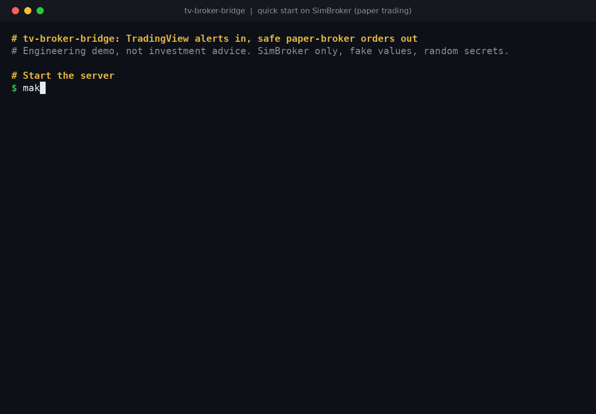

# TradingView-to-broker bridge (demo)

A small, tested service that receives TradingView alert webhooks and routes them to a broker as orders, exactly as your written specification says: no order sent twice, no order past the risk limits, every decision logged, and the broker treated as the source of truth.

> **Engineering demonstration only. Not investment advice. No strategy is included: what to trade, and when, is entirely up to whoever writes the alerts. Use paper trading. You are responsible for any use with a live account.**

## What it does

- **Receives** TradingView webhooks on a FastAPI endpoint behind a shared secret, with strict schema validation; anything malformed is rejected with a logged reason and never reaches the broker.
- **Refuses duplicates:** a repeated `alert_id` (TradingView retries, a double click) never places a second order, even across restarts or concurrent requests.
- **Checks every order against risk rules** from a YAML file (max quantity per order, max position per symbol, max orders per day, allowed symbols, trading hours) and reports every rule it broke.
- **Reconciles** local orders and positions with the broker every few seconds and logs any mismatch; **a kill switch** (command line or secret-protected endpoint) stops new alerts and cancels working orders; a **heartbeat file** and `/health` let something else watch it.
- Ships with an in-process paper broker (`SimBroker`) and an optional Alpaca **paper-trading** adapter that refuses to run against the live endpoint.

## Demo

**Everything in this repository is demo material:** the broker is simulated, the symbols and limits in `config/risk.example.yaml` are arbitrary demo values, and the secrets are generated fresh on your machine. No account, API key or network access to a broker is needed.



About five minutes. Python 3.11 or newer. With `make` (Linux, macOS):

```bash
git clone https://github.com/AZG-Engineering/tv-broker-bridge-demo.git
cd tv-broker-bridge-demo
make install    # creates .venv and installs the package + dev tools
make init       # writes .env with fresh random secrets, and config/risk.yaml
make run        # serves on http://127.0.0.1:8000 with SimBroker
```

Then, in a second terminal: `make demo`, `tv-bridge status`, `tv-bridge check-heartbeat` (after `source .venv/bin/activate`).

The same without `make` (Windows PowerShell; run from the repository folder):

```powershell
python -m venv .venv
.\.venv\Scripts\python.exe -m pip install -e ".[dev]"
.\.venv\Scripts\python.exe scripts\init_env.py
.\.venv\Scripts\tv-bridge.exe serve
```

Second terminal:

```powershell
.\.venv\Scripts\python.exe scripts\demo_alerts.py
.\.venv\Scripts\tv-bridge.exe status
.\.venv\Scripts\tv-bridge.exe check-heartbeat
```

What `demo_alerts.py` prints (a real run, 2026-11-04, Windows, SimBroker):

```text
1. A valid market order
  -> HTTP 200 {"status": "accepted", "alert_id": "demo-…", "order": {"client_order_id": "tvb-…", "broker_order_id": "sim-000001", "status": "filled", "qty": "10", "filled_qty": "10"}}

2. The same alert_id again (TradingView retry / double click)
  -> HTTP 200 {"status": "duplicate", "alert_id": "demo-…", "original_state": "accepted"}

3. Quantity above max_qty_per_order
  -> HTTP 200 {"status": "rejected_by_risk", "alert_id": "demo-…", "violations": [{"code": "qty_exceeds_max_per_order", "detail": "qty 100000 > max_qty_per_order 100"}, {"code": "position_limit_exceeded", "detail": "projected position 100010 would exceed max_position_per_symbol 250"}]}

4. Malformed: qty sent as a string
  -> HTTP 400 {"status": "rejected", "error": "schema_validation_failed", "details": [{"field": "qty", "type": "int_type", "msg": "Input should be a valid integer"}]}

5. Wrong secret
  -> HTTP 401 {"status": "unauthorized"}

6. Health
  -> HTTP 200 {"status": "ok", "problems": [], "version": "0.1.0", "broker": "sim", "kill_switch": {"engaged": false, …}, "reconcile": {…, "last_mismatch_count": 0, "passes": 1}, …}
```

The MP4, the asciinema recording and the architecture and order-state diagrams are in [`docs/media/`](docs/media/README.md).

## How it's built

- **Stack:** Python 3.11+, FastAPI and Pydantic (strict schemas: no coercion, no unknown fields, no duplicate keys), SQLite for alerts, orders, positions and the kill flag, httpx for the broker adapter, YAML for the risk rules. One process, one instance, by design.
- **Idempotency is a transaction, not a cache.** The `alert_id` is claimed, the risk rules are evaluated against current exposure and the order is reserved in one `BEGIN IMMEDIATE` transaction, so a reservation counts toward the limits while the order is in flight. The broker `client_order_id` is derived from the `alert_id`, so a re-send is idempotent at the broker too.
- **The broker is the source of truth.** A reconciler compares local state with the broker on a timer and corrects the local side; an order whose answer was lost is parked as `SUBMIT_UNKNOWN`, keeps counting as exposure, and is resolved by the reconciler.
- **Every decision is one JSON log line** (`received`, `deduped`, `rejected_by_risk`, `sent`, `filled`, `reconciled`, `kill_switch_engaged`, …) with secrets redacted by key name.
- **No credentials in code, paper only.** Secrets and broker keys come from environment variables (`.env.example` holds placeholders only); the loader refuses a missing, short, placeholder or duplicated secret. The Alpaca adapter accepts exactly `https://paper-api.alpaca.markets`, checked at startup and on every request, and never follows redirects. The test suite never contacts a broker.

The alert format, how to point TradingView at it, configuration and risk rules, the HTTP API, the CLI, the log events, the Alpaca paper adapter and the deliberate limitations are in [`docs/REFERENCE.md`](docs/REFERENCE.md); the state machine, failure table and trade-offs are in [`docs/DESIGN.md`](docs/DESIGN.md).

## Tests

```bash
make check      # ruff lint + format check, mypy --strict, pytest: what CI runs
make test       # just pytest
```

Without `make`: `.\.venv\Scripts\python.exe -m pytest` (and `-m ruff check .`, `-m mypy`).

The suite runs entirely on `SimBroker` and mocked HTTP: no network, no real clock (time is injected), no sleeps. It covers duplicate alerts (including concurrent ones and restarts), malformed payloads, every risk rule and its boundaries (DST included), partial fills, broker rejects, reconnects, lost responses, reconciliation mismatches and their races, the kill switch (HTTP, CLI, persistence, broker down), the heartbeat and health endpoint, structured logging with secret redaction, and the paper-only guard.

**399 tests.** CI ([GitHub Actions](https://github.com/AZG-Engineering/tv-broker-bridge-demo/actions), Ubuntu, Python 3.11, 3.12 and 3.13) runs lint, type check and the full suite on every push and is passing on `main`. On Windows (checked 2026-11-04, Python 3.14) 397 pass and two fail for operating-system reasons only: one asserts the generated `.env` has POSIX owner-only permissions, the other expects a `/` path separator in a log line. Lint and `mypy --strict` pass on both.

## Built by AZG Engineering

Built by [AZG Engineering](https://azgengineering.com), small automations and market-infrastructure demos, built from a written specification.

## License

[MIT](LICENSE). Provided as-is, without warranty; see the disclaimer at the top.
