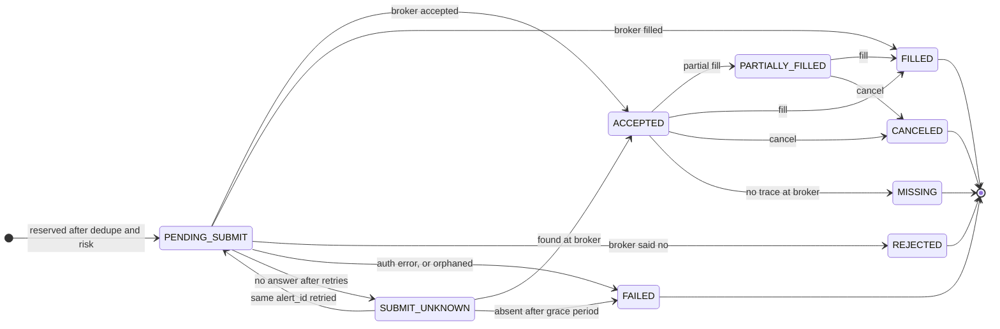

# Design notes

> Engineering demonstration only. Not investment advice. No strategy is included. Use paper trading. You are responsible for any use with a live account.

This document explains *why* the bridge is shaped the way it is: the order state machine, what happens when each thing fails, and which trade-offs were deliberate. The code is the source of truth; every behaviour below is covered by a test (file names in brackets).

## 1. The central problem

A webhook is a fire-and-forget message from a system you do not control, and a broker call is a network request that can fail *after* it succeeded. Three things go wrong in practice:

1. **The same message arrives twice** (retries, double-clicks, proxies).
2. **A broker call times out** and you cannot tell whether the order exists.
3. **Local state drifts** from the broker's (missed fills, manual trades, lost responses).

The design answers each with one mechanism: an atomic claim on `alert_id`, an explicit "outcome unknown" state, and a reconciler that treats the broker as the source of truth.

## 2. Order state machine

`PENDING_SUBMIT`, `SUBMIT_UNKNOWN`, `ACCEPTED` and `PARTIALLY_FILLED` are **working** states: they count as exposure in the risk gate. `FAILED` means "confirmed never to have reached the broker"; `MISSING` means "we thought it was live and the broker has no record".

A separate `alerts` row carries the *idempotency* state: `accepted`, `rejected_risk`, `rejected_broker`, `failed` are final (a repeat is a duplicate), while `submit_unknown` is the only state in which the same `alert_id` may be delivered again.

## 3. Idempotency

`processor._claim` runs one `BEGIN IMMEDIATE` transaction that (a) checks the kill switch, (b) looks up `alert_id`, (c) evaluates risk against exposure *including working orders*, and (d) inserts the alert and a `PENDING_SUBMIT` order. `BEGIN IMMEDIATE` takes the write lock up front, so the check-then-insert is atomic across threads **and** across processes sharing the database file. The primary key on `alerts.alert_id` is a second, structural backstop [`test_idempotency.py`, `test_db_store.py`].

Consequences worth noting:

- A **malformed** or **unauthenticated** alert never claims an `alert_id`, so a corrected re-send is processed normally.
- A **kill-switched** alert does not claim one either, so it is replayable after `resume`.
- The same `alert_id` with a **different payload** is still a duplicate (never a second order) but is logged at WARNING with `payload_matches: false`.
- The broker call uses `client_order_id = "tvb-" + sha256(alert_id)[:32]`. Both adapters are idempotent on it (SimBroker returns the existing order; Alpaca's duplicate-id `422` is translated into a lookup), so even a lost local database cannot cause a second order for the same alert.

Network I/O never happens inside a transaction: the claim commits, *then* the broker is called.

## 4. When things fail

| Situation | What happens | Test |
|-----------|--------------|------|
| Same alert delivered N times | one order, N-1 `deduped` events, `200 duplicate` | `test_idempotency` |
| 32 identical alerts racing in threads | exactly one `accepted` | `test_idempotency` |
| Broker connection fails once | retried with backoff, same `client_order_id`, one order | `test_broker_errors` |
| Broker **accepts but the reply is lost** | retry returns the existing order; position booked once | `test_broker_errors` |
| Broker down for all attempts | order parked `SUBMIT_UNKNOWN`, `503 retryable`; still counts as exposure | `test_broker_errors` |
| …and the sender re-delivers the same `alert_id` after reconnect | delivery completes, still exactly one order | `test_broker_errors` |
| …and nobody retries | reconciler finds it at the broker (`lost_response` alert) or, after `UNKNOWN_GRACE_S`, marks it `FAILED` (`unsent` alert) and **does not resend it** | `test_broker_errors` |
| Broker returns a definitive reject | `REJECTED`, `200 rejected_by_broker`, `broker_rejected` event; repeat is a duplicate | `test_order_flow` |
| Broker rejects our credentials | not retried; order `FAILED`; `CRITICAL` log; `502` | `test_broker_errors` |
| Unexpected exception in the handler | `500`, no stack trace to the caller; the orphaned reservation is closed out by the reconciler | `test_broker_errors` |
| Process dies mid-submit | on restart the `PENDING_SUBMIT` row ages out and is resolved like `SUBMIT_UNKNOWN` | `test_broker_errors` |
| Kill switch thrown mid-submit | the straggler is cancelled right after it is recorded | `test_kill_switch` |
| Kill switch thrown while the broker is down | alerts stop at once; `cancel_pending` stays set and the heartbeat loop retries until it works | `test_kill_switch` |

**Why never auto-resend an unconfirmed order?** After `UNKNOWN_GRACE_S` the market, the trading window and the sender's intent may all have changed. Placing it late "to be safe" is the failure mode this project exists to avoid. It is failed, alerted, and a new `alert_id` is required.

## 5. Reconciliation

Each pass snapshots the broker's orders and positions, diffs them against the local database, and **replaces local state with the broker's**. Differences are classified:

| Finding | Kind | Alert? |
|---------|------|--------|
| Working local order now reports more fills or a terminal state | `progress` | no (this is how async fills are learned; logged as `filled`) |
| Broker holds a **working** order the bridge never recorded | `unknown_broker_order` | yes; it is adopted so its exposure is visible to risk |
| Local order marked live, broker has no trace (after a direct lookup) | `missing_at_broker` | yes |
| Order was `SUBMIT_UNKNOWN`/orphaned and exists at the broker | `lost_response` | yes |
| Order was `SUBMIT_UNKNOWN`, absent, and older than the grace period | `unsent` | yes |
| Broker reports fewer fills than we recorded | `fill_regression` | yes |
| Local says terminal; broker disagrees | `terminal_state_conflict` | yes |
| Position quantity differs after the above is applied | `position_mismatch` | yes |

Closed, historical broker orders the bridge does not know about are ignored.

Two subtleties, both found by tests rather than by inspection:

- **The snapshot is not atomic.** A fill can land between the "orders" request and the "positions" request. Any pass that finds a mismatch is therefore **re-observed against a fresh snapshot**, and only mismatches present in the second observation count [`test_a_fill_landing_between_the_two_requests_is_not_a_false_alarm`].
- **The reconciler races the live submit path.** An order whose submit is in flight has already filled at the broker but is not yet booked locally. Naively "correcting" the position would overwrite it, and the submit path would then add the fill again (double-counted position). Two guards close this: young `PENDING_SUBMIT` orders, and their symbol's position, are left alone; and a **change token** (a counter bumped on every order/position write) discards the whole pass if anything was written locally while it was observing, retrying a few seconds later [`TestRacesWithTheLiveSubmitPath`].

## 6. Risk gate

`risk.evaluate` is a pure function of `(config, alert, exposure snapshot)`; it never does I/O, so every rule is unit-tested at its boundaries. It returns *all* violated rules, so one log line explains a rejection fully.

- **Exposure = net position + remaining quantity of working orders** (including unknown ones), so a burst of resting orders cannot sneak past the position limit.
- **Reducing orders are always allowed** by the position rule; otherwise a position pushed over the limit by a manual trade could never be worked down.
- **Orders per day** counts every order *attempted* (broker rejects included), in the configured timezone's calendar day (DST-safe), so a runaway sender cannot burn unlimited broker round-trips.
- **Config is strict and mandatory**: unknown keys, missing keys, non-positive limits, bad timezones and malformed times are all startup errors. There is no "unlimited" default.

## 7. Kill switch

State is one row in SQLite, so it is shared between the HTTP endpoint and the CLI (separate processes), survives restarts, and is read on every alert inside the claim transaction. It is **engaged by HTTP or CLI and released by CLI only**: re-arming trading should need a human on the host. The admin secret is separate from the webhook secret, because the webhook secret travels inside TradingView alert bodies.

Engaging is a two-phase operation: *stop accepting* (instant, local) then *cancel everything* (a broker call that may fail). The second phase is retried by the heartbeat loop for as long as `cancel_pending` is set.

## 8. Concurrency model

Sync FastAPI handlers run in a thread pool; two daemon threads run the reconcile and heartbeat loops. One SQLite connection per process, guarded by a re-entrant lock, with WAL for other processes. Reconciliation passes are serialised by a lock (the periodic loop and the post-kill sync both call it). An exception inside a loop is logged (`loop_error`) and the loop continues.

## 9. Deliberate non-goals and what I would add for production

- **Multi-instance deployment**: would need a real database (Postgres advisory locks or a unique constraint plus a proper queue) and leader election for the reconciler.
- **Event-driven fills** (broker websocket) in addition to polling; polling is simple and the reconciler is the safety net either way.
- **Metrics and paging integration** behind `AlertSink`; today it logs.
- **Authentication hardening**: HMAC-signed bodies and replay windows if the sender could sign; rate limiting and IP allow-listing at the edge.
- **Pruning** of the `alerts` table with a retention window longer than any sender's retry horizon.
- **Fractional shares, order amendments, bracket orders, time-in-force options.**
